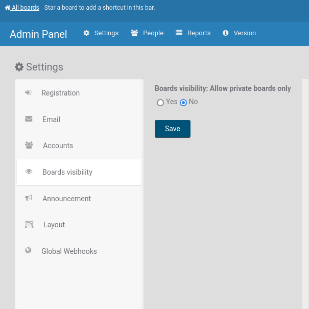

# Admin Panel / Settings / Appearance

## What it is

How this WeKan looks: what All Boards shows, dates, how wide a card opens, the
URLs it links to, its product name, colours and logos. Address:
`/admin/settings/appearance`. Every group except Change color is for site
administrators; an Organization's own admin sees only Change color.

Until 2026-11-19 this pane was **Visibility**, and it also held which features
the instance offers. Those are [Features](Features.md) and
[Feature profiles](Feature-Profiles.md) now, and `/admin/settings/visibility`
redirects here.

## Read more

- [Theme (computing)](https://en.wikipedia.org/wiki/Theme_(computing)) and
  [Color picker](https://en.wikipedia.org/wiki/Color_picker) on Wikipedia -
  what Change color is.
- [ISO 8601](https://en.wikipedia.org/wiki/ISO_8601) on Wikipedia - the
  `YYYY-MM-DD` date format.
- [List of URI schemes](https://en.wikipedia.org/wiki/List_of_URI_schemes) on
  Wikipedia - what Custom URL schemes lists.
- [Follina](https://en.wikipedia.org/wiki/Follina_(security_vulnerability)) and
  [NTLM](https://en.wikipedia.org/wiki/NTLM) on Wikipedia - why some schemes are
  never linked and why `file` needs care.
- [Throbber](https://en.wikipedia.org/wiki/Throbber) on Wikipedia - a wait
  spinner; WeKan's are in [Wait Spinners](../../General/Troubleshooting/Wait-Spinners.md).
- [Design / Change color](../../General/Theme/Change-Color.md),
  [Card details width](../../Cards/Card-Details-Width.md) and
  [Multitenancy](../../../Design/Multitenancy/Multitenancy.md).

## How to use it

Open **Admin Panel / Settings / Appearance**. Each group has its own **Save**
directly above the rule that closes it. A Save writes only its own group's
fields, so saving one cannot carry half-typed edits from another. Change color
has no Save.

### All Boards: Hide

Each row is ticked when the thing is **hidden**.

- **Public boards** — hide them: only private boards may be created, and existing
  public boards are not offered. This is the setting stored as
  `tableVisibilityMode-allowPrivateOnly`; a board you may not open says so with the
  same string. ([Wekan v5.55 and newer](../../../../CHANGELOG.md#v555-2021-08-31-wekan-release))

  

- **Only admins can create boards** (\#4475) — ticked, nobody but a site
  administrator may create a board; template boards can still be made. Stored
  as `tableVisibilityMode-boardCreationAdminOnly`, and enforced on every
  server path that creates a board.
- **Boards that every signed-in user can edit** (\#4575). This row is ticked when
  the feature is **allowed**, not hidden, and it is off by default. When it is
  on, a board admin can open an **Instance** or **Public** board to editing by
  every signed-in user: in the board's visibility popup, tick **Everyone signed
  in can edit**.

  Such a user may add, edit and move cards and comment, like a **Normal**
  member. They can never change the board's settings, members or roles. Their
  first edit makes them a Normal member, so the member list shows who has
  edited, and a board admin can change their role or remove them like any other
  member. A removed user stays removed.

  Rules, webhooks, email and list sync do not get these rights: they act only
  for members. The setting is stored as
  `tableVisibilityMode-allowInstanceEditing`. Unticking it takes the right away
  from every board at once; members who have already joined keep their
  membership.
- **Board activities** — do not show the activity feed on All Boards. One global
  setting, read once by the feed, so turning it off restores each board's own value.
- **Card counter list** — hide the per-list card counts on All Boards.
- **Board member list** — hide the member avatars on All Boards.
- **Wait Spinner** — which spinner is shown while something loads, with a live
  preview beside the dropdown. See
  [Wait Spinners](../../General/Troubleshooting/Wait-Spinners.md).
- **Custom private description** and **Custom public description** (\#4421) —
  the text shown under Private and Public in the board visibility popup and the
  create-board popup, for an organization whose "Public" means "public within
  our organization". Empty keeps the default text.

### Date

- **Date Format:** — tick it and choose `YYYY-MM-DD`, `DD-MM-YYYY` or
  `MM-DD-YYYY`, each with the time or as a date only, then **Save**. Cards use
  that format for members and anonymous viewers, overriding personal
  date-format preferences unless a member has set an override of their own, or
  the board has one. Opened cards show **Date** instead of **Date Format** and
  hide the format dropdown. Unticking restores personal formats; stored dates
  and calendar choices are unchanged.

### Card details default width

- The width every card details window opens at (\#6939), in percent of the
  browser window. When a user drags a card wider or narrower, every card opens
  at that width for that user. See
  [Card details width](../../Cards/Card-Details-Width.md).

### URL

- **Support** — the link to `/support`, whether the page is enabled (**Support
  page enabled**), whether it is **Public** (readable without signing in), and
  its **Support title** and **Support content**.
- **Custom Help Link URL** — where the Help item points.
- **Custom legal notice page URL** — shown on the sign-in page.
- **Custom URL Schemes** — the extra URL schemes that are turned into links
  automatically in card text, one per line. Empty by default, so only web and
  mail links are clickable. Anything not listed is left as plain text, which is
  what stops `javascript:` and friends becoming clickable.

  Each listed scheme opens the application the viewer's computer has for it, so
  a link is something that runs on the machine of whoever clicks it, written by
  anybody who can edit a card. Two kinds of scheme are never linked, even when
  listed here:

  - schemes that run code in the page or hide content in the URL: `javascript`,
    `vbscript`, `data`, `blob`, `about`, `view-source`, `mhtml` and the like;
  - operating-system handlers with a public code-execution history: `ms-msdt`
    (Follina, CVE-2022-30190), `search-ms` and `search`, `ms-officecmd`,
    `ms-appinstaller`, `ms-cxh` and `ms-cxh-full`, and `telnet` - the last step
    of a 2026 browser full chain, where Windows ran a `telnet.exe` from a
    directory any user can write to.

  Somebody writing a link to one of the second kind in a card title or
  description, a comment or a checklist is shown in **Admin Panel → Problems**
  (HandlerLink, CWE-939): nobody needs such a link, because it is never
  clickable. The text is saved as written, and nothing is said to the writer.

  `file` is allowed, because linking a shared folder is what the setting is for
  ([#3218](https://github.com/wekan/wekan/issues/3218)). On Windows a
  `file://server/share` link is opened over SMB, and a link to a server
  outside your network sends that server the clicker's Windows sign-in (an NTLM
  hash). List `file` only where everybody who can edit cards is trusted, and
  block outbound SMB (TCP 445) at the network edge.

### External Issue Tracker Autolink

Turns references in card text into links to another tool (\#3069, \#1463).

- **Token Prefix** (for example `#`) and **URL Template (use {number})** (for
  example `https://issues.example.com/browse/PROJ-{number}`): `#1234` in a card
  becomes a link to issue 1234. Leave either empty to turn it off.
- **More link rules** — one rule per line: the text to find, ` = `, and the
  address, with `{number}` for digits and `{identifier}` for a word in both,
  for example `[{identifier}:{number}] = https://tracker.example.com/{identifier}/{number}`.
- **Abbreviations for {identifier}** — for example `TK=Task, IN=Incident`.

### Custom Product Name

The name WeKan calls itself: the browser tab title, and the branding on the sign-in
page and the progress dashboards. The tab title changes as soon as you save.

### Change Color

The theme of this site: the same picker as Board Settings / Change Color and Member
Settings / Change color — the categories of swatches, the "Default theme" row and the
custom-colour wheels — described in
[Design / Change color](../../General/Theme/Change-Color.md). It applies as soon as you
click a colour; there is no Save button.

**The order of themes**, weakest first:

1. WeKan's default theme.
2. **This** setting — what everyone sees who has not chosen a theme of their own.
3. A user's own override, from Member Settings / Change color.

A board's own colour is not one of those layers: it is what a board looks like, and it
owns the board page. A user's own override still applies there, because they asked for
it everywhere.

The line under the section title, *"Override that applies to all tenants"*, is there
for a site admin: an Organization that has set a colour of its own keeps it on its own
domains, and every Organization that has not inherits this one. An Organization's own
admin sees this section — and only this section of the pane — and sets that
Organization's colour. See [Multitenancy](../../../Design/Multitenancy/Multitenancy.md).

### Logo

- **Hide Logo** — do not show it at all.
- **Custom Login Logo Image URL** and **Custom Login Logo Link URL**, and the
  **Text below Custom Login Logo**.
- **Login page background color** — a colour such as `#1b365d` (\#6866).
- **Custom Top Left Corner Logo Image URL**, **Link URL** and **Height**
  (default 27 px; width auto).
- Beside each logo URL, an **Upload** button stores an image in WeKan and fills
  in the URL.

Sizes: the top-left corner logo is 27 px high, the login logo 300 px wide, the other
dimension automatic; a logo a little larger or smaller is scaled. jpg, png, gif and
svg all work as a URL.

An image can be hosted anywhere (`https://example.com/logo.png`). To keep it inside
WeKan: use **Upload**, or create a public board, add a card, attach the image, then
copy the image link into the field here.

## How the numbers are calculated

- **Card details default width**: a whole number from **30** to **95** percent;
  a value outside is moved to the nearest end, empty means none. The window
  then opens at `clamp(520px, <percent>vw, 100vw - 16px)`: never narrower than
  **520 px** and never wider than the window less 8 px each side. Empty means
  520 px. A user's dragged width (kept between 280 and 10000 px) wins over it
  ([models/lib/cardDetailsWidth.js](../../../../models/lib/cardDetailsWidth.js)).
- **Date format** is chosen in this order
  ([models/lib/dateFormatPolicy.js](../../../../models/lib/dateFormatPolicy.js)):
  a member's own override, then the board's override, then this setting when
  ticked, else `YYYY-MM-DD`.
- **Top-left logo height**: 27 px by default.
- **Upload**: PNG, JPEG, GIF or WebP, at most **2 MB**
  ([server/siteLogoUpload.js](../../../../server/siteLogoUpload.js)).
- **More link rules**: at most **50** rules are used; a rule needs exactly one
  `{number}`, at most one `{identifier}`, and an `http` or `https` address
  ([npm-packages/autolink/externalLinkRules.js](../../../../npm-packages/autolink/externalLinkRules.js)).

## How it works in WeKan

- **Pane**: template `tableVisibilityModeSettings` with `part="appearance"` in
  [settingBody.jade](../../../../client/components/settings/settingBody.jade);
  the same template draws Features and Feature profiles. The Save handlers in
  [settingBody.js](../../../../client/components/settings/settingBody.js) write
  only the fields their group shows.
- **Storage**: the three board switches are documents of
  `tableVisibilityModeSettings`
  ([server/permissions/tableVisibilityModeSettings.js](../../../../server/permissions/tableVisibilityModeSettings.js));
  everything else is a field of the settings document
  ([models/settings.js](../../../../models/settings.js)), updated by a site
  administrator only ([server/permissions/settings.js](../../../../server/permissions/settings.js)).
- **Board creation**: [models/lib/boardCreationPolicy.js](../../../../models/lib/boardCreationPolicy.js)
  and [client/lib/boardCreationAllowed.js](../../../../client/lib/boardCreationAllowed.js).
  **Instance editing**: [client/lib/instanceEditing.js](../../../../client/lib/instanceEditing.js).
- **URL schemes**: [models/lib/urlSchemeAllowlist.js](../../../../models/lib/urlSchemeAllowlist.js);
  the HandlerLink record is the `xss.handler-link` key of
  [models/lib/securityCategories.js](../../../../models/lib/securityCategories.js).
- **Autolinks**: [npm-packages/autolink/](../../../../npm-packages/autolink/),
  shared by the app and the markdown package.
- **Theme**: the colour picker writes the site theme; an Organization admin's
  target is decided in [models/lib/tenantAdmin.js](../../../../models/lib/tenantAdmin.js).
- **Logo upload**: method `uploadSiteLogo` in
  [server/siteLogoUpload.js](../../../../server/siteLogoUpload.js), site admin
  only, stores the image as an attachment.
- **Tests**: [tests/boardCreationAdminOnly.test.cjs](../../../../tests/boardCreationAdminOnly.test.cjs),
  [tests/instanceEditing.test.cjs](../../../../tests/instanceEditing.test.cjs),
  [tests/globalDateFormat.test.cjs](../../../../tests/globalDateFormat.test.cjs),
  [tests/cardDetailsWidth.test.cjs](../../../../tests/cardDetailsWidth.test.cjs),
  [tests/urlSchemeAllowlist.test.cjs](../../../../tests/urlSchemeAllowlist.test.cjs),
  [tests/externalLinkRules.test.cjs](../../../../tests/externalLinkRules.test.cjs),
  [tests/loginBackground6866.test.cjs](../../../../tests/loginBackground6866.test.cjs)
  and [tests/siteLogo.test.cjs](../../../../tests/siteLogo.test.cjs).

## Related

- [All Boards](../../All-Boards/Boards.md)
- [Members and Permissions](../../Board-Sidebar/Members/Members.md)

## Commits

 - [Card details window: an admin sets the default width as a percentage (#6939)](https://github.com/wekan/wekan/commit/9372148915cff7824b64e06fca337d696e51e3df)
 - [One copy of the autolinks, shared by the app and the markdown package](https://github.com/wekan/wekan/commit/eb0df61e7f9681379491dc45431b7373271e7614)
 - [Visibility becomes Appearance; features move to their own panes](https://github.com/wekan/wekan/commit/e1a053d059191640a63a22ab553c0b0c6b833d8d)
 - ["Only admins can create boards" holds on every path (CreateBleed)](https://github.com/wekan/wekan/commit/5c1f6088f44c5c3e26a4808c20c4e5550a61f710)
 - [A login page background colour (#6866)](https://github.com/wekan/wekan/commit/6b27764452c5d3d3876878dfd1071db3960ba3c0)
 - [Card links never launch an OS handler with a code-execution history (HandlerLink)](https://github.com/wekan/wekan/commit/b4e5f90afb87442e2152d79d7f0cadf4dacd4e16)
 - [The Private and Public descriptions are shown again](https://github.com/wekan/wekan/commit/437da1d9c7a7371831942125d5e0715131061deb)
 - [The site logo upload is stored again](https://github.com/wekan/wekan/commit/e7505a4fef50dbbc7003c74423372f48b11bc366)
 - [Boards every signed-in user may edit (#4575)](https://github.com/wekan/wekan/commit/7595727917d436ea71969d6d74d166b42b38ed4e)
 - [Autolink references with an identifier and abbreviations (#1463)](https://github.com/wekan/wekan/commit/ed993fef844923b37648d710a9fcc593ca61583a)
 - [Board imports honour "private boards only"](https://github.com/wekan/wekan/commit/3af89a6a0062be23a1b405b22eb37ffa45e1ff9c)
 - [Custom URL schemes are linked only when an administrator lists them](https://github.com/wekan/wekan/commit/b7a3b29a2bb1ff45e5abeda4bbb82b662c9667ab)
 - [Date format controls for the instance, the board and the member](https://github.com/wekan/wekan/commit/94b59bef014503e5dd8aaeb5ebf8500311b96daf)
 - [Date-only formats](https://github.com/wekan/wekan/commit/16b1b307fc365049f4ea59f3e310ac47b8543b4c)
 - [An admin date format for everyone](https://github.com/wekan/wekan/commit/46607d4299cf51836b892be91490111a1f81bb7e)
 - [Configured logos load without the stock logo flashing, and can be uploaded](https://github.com/wekan/wekan/commit/593cab59116b65cd4ed708e838c5ce9a5870a0e6)
 - [Only admins can create boards (#4475)](https://github.com/wekan/wekan/commit/52972b3e4cacdc451e5840709f505e98db285913)
 - [Custom colour is offered in the Admin Panel too](https://github.com/wekan/wekan/commit/024036f4ee4b976f51bf6a032aa9b5d8c3916138)
 - [A file:// link no longer makes a card impossible to open (#6588)](https://github.com/wekan/wekan/commit/75a23b76ae64a179e72e61c04daba9e54b9f8908)
 - [All Boards: Hide is four checkboxes](https://github.com/wekan/wekan/commit/d48a467e9b4f0c5c983e7806aff36e73ea768310)
 - [The site theme reaches the top bars too](https://github.com/wekan/wekan/commit/eebb0a7d8c5073e165f69ab99b6707d08b35f8d3)
 - [Hide board activities becomes one global setting](https://github.com/wekan/wekan/commit/4009d92ebde35609b3607e9c88c6ba0efba07c9a)
