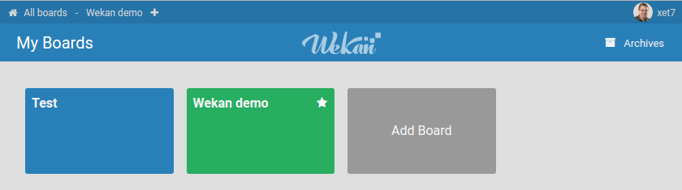
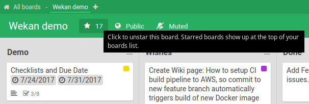
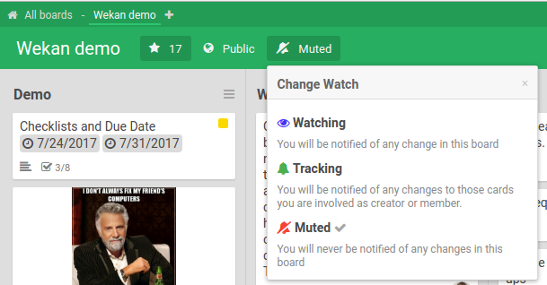
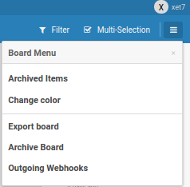
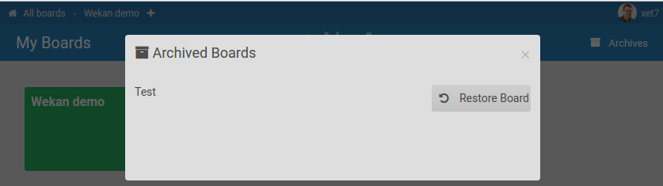

# Boards

## What it is

A **board** is a Kanban board that holds your swimlanes, lists and cards. You can
have any number of public and private boards. The **All Boards** page lists all
of them; a board can be starred, watched, archived and restored.

## Read more

- [Kanban board](https://en.wikipedia.org/wiki/Kanban_board) and
  [Kanban (development)](https://en.wikipedia.org/wiki/Kanban_(development)) on
  Wikipedia
- [Bookmark (digital)](https://en.wikipedia.org/wiki/Bookmark_(digital)) - what a
  star is
- [Progressive web app](https://en.wikipedia.org/wiki/Progressive_web_app) - the
  standalone app mode
- [All Boards](README.md), [Starred](../Pages/Starred.md),
  [Archive](Archive.md) in these docs

## How to use it

### List of all your boards

The **All Boards** page lists all of your public and private boards. The number
of things you have starred is shown in the first header bar, as a caret and a
count; clicking it opens the list of your starred boards and other starred
items.

### Star a board

1. Open the board, or point at its tile on All Boards.
2. Click the star icon (*Click to star this board. It will show up at top of
   your boards list.*).

Starred boards appear in the **Starred** section of All Boards and in the
**Starred** dropdown of the first header bar.

### Watch a board

Watching a board (or list/card) controls which activities create notifications for
you.

1. Open the board.
2. Click the watch button in the board header.
3. Choose **Watching** (*You will be notified of any change in this board*),
   **Tracking** (*You will be notified of any changes to those cards you are
   involved as creator or member.*) or **Muted** (*You will never be notified
   of any changes in this board*).

### Board menu (hamburger)

1. Click the 3-lines "hamburger" at the end of the first header bar
   (**Open Sidebar**) to open the right sidebar.
2. Click **Board Settings** (the cog) at the top of the sidebar.

There you can change board settings, add/remove members, configure webhooks,
import/export, archive, and more.

### Restore an archived board

Archived boards are not deleted - you can restore them from the archive.

1. Open **All Boards / Archive**.
2. Find the board, using the search if needed.
3. Click **Restore Board**, or drag the board onto **Remaining** or a
   workspace.

### Full screen / standalone app mode

- **Desktop:** WeKan can run as a full screen or standalone window (without browser
  buttons). See [browser standalone app mode](https://github.com/wekan/wekan/pull/1184).
- **Mobile Firefox:** see [instructions and screenshot](https://github.com/wekan/wekan/issues/953#issuecomment-336537875).

## How the numbers are calculated

- The **star count** in the first header bar is everything you have starred:
  starred boards + starred pages + starred swimlanes + starred lists + starred
  cards (`starredCount()` in [models/users.js](../../../models/users.js), shown
  by `starredBoardsCount` in
  [client/components/main/header.js](../../../client/components/main/header.js)).
- There is no limit on how many boards you may have or star.

The counts beside each All Boards section are explained in
[All Boards](README.md#how-the-numbers-are-calculated).

## How it works in WeKan

- A board is a document of the `boards` collection
  ([models/boards.js](../../../models/boards.js)); its members are in
  `members`, its visibility in `permission`, and archiving sets `archived` and
  `archivedAt`.
- Starring writes the board id into the user's `profile.starredBoards`
  ([models/users.js](../../../models/users.js)).
- Who watches a board, list or card is kept in its `watchers` array
  ([models/watchable.js](../../../models/watchable.js)); the
  header button is in
  [client/components/boards/boardHeader.jade](../../../client/components/boards/boardHeader.jade).
- Board Settings is `boardMenuPopup`, opened from
  [client/components/sidebar/sidebar.jade](../../../client/components/sidebar/sidebar.jade).
- Restoring is in
  [client/components/boards/boardArchive.js](../../../client/components/boards/boardArchive.js).

### Related

- [Board Background Images](../Board-Sidebar/Board-Settings/Background-Image.md)
- [Allow private boards only: Disable Public Boards](../Admin-Panel/Settings/Appearance.md)
- [Swimlanes](../Swimlanes/README.md)
- [WIP Limits](../Lists/WipLimit/README.md)
- [Templates](Templates.md)
- [Archive and Delete](../Board-Sidebar/Archive/Archive-and-Delete.md)
- [If board does not open and keeps loading](../Troubleshooting/If-board-does-not-open-and-keeps-loading.md)

## Commits

 - [Header: starred boards are a dropdown with a count, not a row of links](https://github.com/wekan/wekan/commit/af6cdf7dc0f111532303ca1f75a17e374d7f17fe)
 - [Watch boards, lists and cards, and get notifications](https://github.com/wekan/wekan/commit/9bbdacc79a89667e0d6f1ed30c415e5350ad468b)
 - [Archive and restore a board](https://github.com/wekan/wekan/commit/48ac8b026ffdf8b3823c573e5693dcf1765383e2)
 - [Boards, stars and the board header in the first WeKan code](https://github.com/wekan/wekan/commit/2dbea30842ec63a68055245fe26633bb7913daf3)
