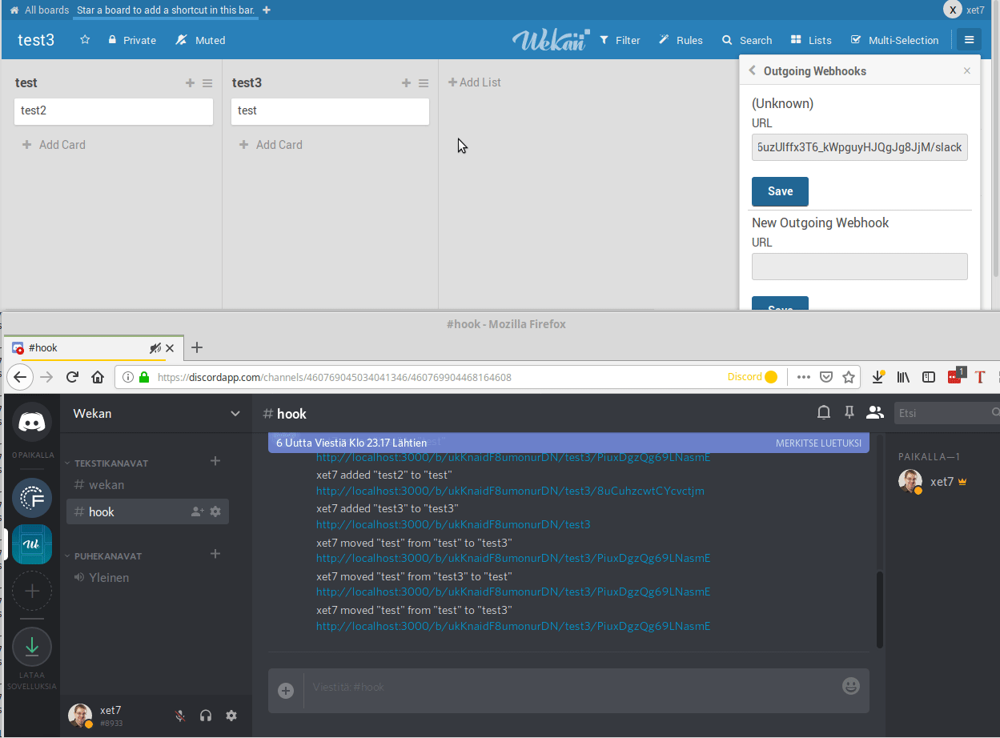

# Outgoing webhook to Discord

## What it is

A board's activities posted to a Discord channel through Discord's incoming
webhook. WeKan's outgoing webhooks are in the Slack format, which Discord
reads when `/slack` is added to the end of its webhook address.

## Read more

- [Wikipedia: Discord](https://en.wikipedia.org/wiki/Discord)
- [Discord: Execute Slack-compatible webhook](https://discord.com/developers/docs/resources/webhook)
- [Webhook data](../Webhook-data.md)

## How to use it

- [RocketChat Webhook workaround](https://github.com/wekan/univention/issues/15)

Note: Webhook to Slack and Rocket.Chat does not require adding anything to URL. Discord requires adding `/slack` to end of URL so that it works.



1. Add Webhook to Discord

2. On the WeKan board, click the 3 lines "hamburger" menu, then Board Settings / Outgoing Webhooks.

3. Add /slack to end of your Discord Webhook URL and Save URL, like this: 

```
https://discordapp.com/api/webhooks/12345/abcde/slack
```

The steps of the WeKan form are those of every outgoing webhook:

1. Open the board, its right sidebar, then **Board Settings → Outgoing
   Webhooks** (board admins; for every board at once, Admin Panel → Settings
   → Global Webhooks).
2. Write the **Webhook Name**, the **URL** the receiver gave you and, when the
   receiver wants one, the **Token (Optional for Authentication)**.
3. Choose the type (**Outgoing Webhooks**) and under **Send this webhook:**
   either **Every activity** or the activities to send.
4. Click **Create**. A saved webhook can be changed and saved again, or turned
   off with **Disable This Webhook**.

Wekan Outgoing Webhook URLs are in Slack/Rocket.Chat/Discord format.

Note: Not all Wekan activities create Outgoing Webhook events. Missing activities [have been added](https://github.com/wekan/wekan/issues?utf8=%E2%9C%93&q=is%3Aissue+is%3Aopen+webhook) to the Wekan Roadmap. If you find some activity that does not yet have GitHub issue about it, please add new GitHub issue.

Wekan uses this type of JSON when sending to Outgoing Webhook:
[Webhook data](../Webhook-data.md)

Discord supports incoming webhooks in different formats, like GitHub, Slack, etc. The incoming format needs to be specified by adding webhook format to end of URL.
https://discordapp.com/developers/docs/resources/webhook#execute-slackcompatible-webhook

Wekan generated webhooks are Slack compatible. Discord does not know anything about Wekan, Rocket.Chat, and other apps that produce Slack compatible Outgoing Webhook format. But using any other format like GitHub etc does not work, because Wekan Outgoing Webhooks are not in that format.

When making Wekan Outgoing Webhook to Rocket.Chat and Slack, there is no need to add anything to Webhook URL when those that is added to Wekan board. Discord in this case has decided to implement multiple Incoming Webhook formats and require specifying format in URL.

### Riot (Element)

Wekan boards have Outgoing Webhooks for board change messages, those can be bridged to Riot:
https://github.com/element-hq/element-web/issues/4978

If you have some Riot bot, you can make it call Wekan REST API to make changes to Wekan.
First [login to API as form data, with admin username and password](../../../../../API/REST-API.md#example-call---as-form-data). Then use that Bearer token [to edit Wekan](https://wekan.fi/api/).

## How the numbers are calculated

The numbers every outgoing webhook has:

- **Timeout**: one request may take 30 seconds (`totalTimeoutMs: 30000` in
  [server/notifications/outgoing.js](../../../../../../server/notifications/outgoing.js)).
  A 2xx answer is success.
- **At once or queued**: a webhook with the built-in delivery settings is
  POSTed at once. One whose delivery groups or schedules its notifications
  goes through the durable queue
  ([server/lib/webhookOutbox.js](../../../../../../server/lib/webhookOutbox.js)),
  scanned every 5 seconds: at most 100 jobs a pass, a body of at most 1 MB,
  and a failed job is tried again after `min(60 minutes, 30 seconds x
  2^(attempts - 1))` - 30 s, 1 min, 2 min, 4 min ... - up to 10 attempts.
- **Internal destinations**: Admin Panel can list at most 50 hosts on WeKan's
  own network that webhooks may reach
  ([models/lib/internalWebhookHosts.js](../../../../../../models/lib/internalWebhookHosts.js)).

## How it works in WeKan

A webhook is a document of the `Integrations` collection
([models/integrations.js](../../../../../../models/integrations.js)): the board it
belongs to (`_global` for Admin Panel → Settings → Global Webhooks), its type
(Outgoing Webhooks, or Two-Way Webhooks whose answer can change the board), its
name, URL, optional token and the activities it sends. Only a board admin or a
site admin may add, change or remove one, and it cannot be moved to another
board ([server/permissions/integrations.js](../../../../../../server/permissions/integrations.js)).
When a board activity happens,
[server/notifications/outgoing.js](../../../../../../server/notifications/outgoing.js)
builds the JSON body ([models/lib/webhookPayload.js](../../../../../../models/lib/webhookPayload.js),
described in [Webhook data](../Webhook-data.md))
and POSTs it through the outgoing request guard
([server/lib/ssrfGuard.js](../../../../../../server/lib/ssrfGuard.js)), which
refuses private, loopback and link-local addresses unless Admin Panel lists
them, and trusts `WEBHOOK_TLS_CA_CERT` for TLS. The webhooks are set in
`outgoingWebhooksPopup` in
[client/components/sidebar/sidebar.jade](../../../../../../client/components/sidebar/sidebar.jade).

## Commits

 - [Fix bare wiki-style links to relative paths of existing docs pages](https://github.com/wekan/wekan/commit/7b66884ba3e1206aea6e0cf57507cceffa5c91bf)
 - [Add the docs from the wekan.wiki, this page among them](https://github.com/wekan/wekan/commit/73ae73d4c38640e9daedbe8ef9e5b25b877ee804)
