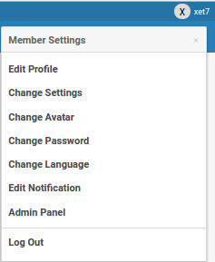
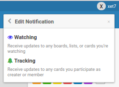
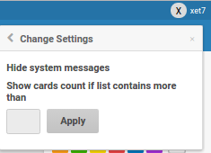
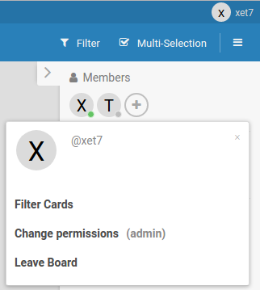
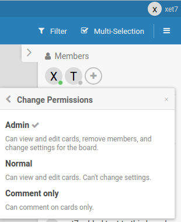

# Members and Permissions

## What it is

Boards can have many members, so you can collaborate with your team. You add
members to a board, and optionally assign them to individual cards. Each member has one role on the board, which decides what they
may see and do; a board can also be shared with a whole email domain, an
Organization or a Team.

## Read more

- [Wikipedia: Role-based access control](https://en.wikipedia.org/wiki/Role-based_access_control)
- [Board roles - what each one may and may not do](Roles.md)
- [Adding Users](../../Login-Page/Adding-users.md)
- [Admin: Impersonate user](../../Login-Page/Impersonate-user.md)
- [Admin Panel](../../Admin-Panel/README.md)

## How to use it

### Member settings menu

Click your username/avatar in the top right corner to open your member settings.

> NOTE: The duplicate "Edit Notification" entry was removed from this menu in
> [PR #1948](https://github.com/wekan/wekan/pull/1948), so Edit Notification is only
> available from the menu shown below.

#### Edit Notification

#### Change settings (for example hide system messages)

### Board members

Click a member's initials or avatar to filter the board by that member, or to open
the member's permission settings.

### Permissions: the board roles

Click a member's initials or avatar to set their role on the board. There are
nine, and the short version is:

- **Board admin** — full control of the board, including its settings and who is
  on it.
- **Normal** — can create and edit cards, lists and swimlanes, and comment.
- **No comments** — as Normal, but cannot comment.
- **Comment only** — can only add comments, not edit anything.
- **Worker** — can move cards and comment, but not edit them.
- **Read only** — can see the board and nothing else.
- ...and an **assigned only** variant of Normal, Comment only and Read only, which
  additionally sees *only the cards it is assigned to*.

**[Board roles — what each one may and may not do](Roles.md)** is the full
comparison table, column by column, written from the code — including the places
where a role does not yet do what its name says.

### Share a board with an email Domain

In the board members sidebar there is a **Domains** tab. From it you can share a
board with a whole email **domain** (for example `example.com`), so every user with
a verified email address on that domain becomes a member of the board. This is in
addition to sharing with individual members, Organizations and Teams.

## How the numbers are calculated

- **Roles**: a member has exactly one of nine roles; how each is decided is in
  [Board roles](Roles.md#how-the-numbers-are-calculated).
- **Notify on assign**: `NOTIFY_ON_ASSIGN` is `true` by default.

## How it works in WeKan

Board members are the `members` array of the board
([models/boards.js](../../../../models/boards.js)): each with `userId`,
`isActive` and the role flags (`isAdmin`, `isNoComments`, `isCommentOnly`,
`isWorker`, `isReadOnly` and the assigned-only flags), or a `customRoleId`.
Every permission check asks the capability table in
[models/lib/boardRoleCapabilities.js](../../../../models/lib/boardRoleCapabilities.js),
described in [Board roles](Roles.md).

### Notify on assign

When a user is added as a card **member** or **assignee**, they can be notified
directly. This is controlled by the environment variable:

- `NOTIFY_ON_ASSIGN` (default `true`) — when `true`, the user added as a card
  member/assignee gets a direct notification. Set to `false` to disable these
  notifications instance-wide. On Snap use `notify-on-assign`.

### Restrict board members to the same Organization or Team

On multi-tenant instances you can require that a board's members share an Organization
or a Team. There is one admin checkbox per kind -
[`boardMembersFromSameOrgOnly`](../../Admin-Panel/People/Organizations.md) in Admin Panel /
People / Organizations and
[`boardMembersFromSameTeamOnly`](../../Admin-Panel/People/Teams.md) in / Teams -
and when either is on, a user can only be added to a board if they share an enabled
kind with the inviter or with an active board member (site admins bypass this). See
[Admin Panel](../../Admin-Panel/README.md).

## Commits

 - [Custom board roles, and team memberships that leave with the team](https://github.com/wekan/wekan/commit/50bb989eb8d90ed9bfafbceb3f9f8e68e208116e)
 - [Clarify local member removal on Sandstorm](https://github.com/wekan/wekan/commit/b9cfc1d8d4e01ebef75490e7e275cebfeee35654)
 - [Board sidebar: Members and Labels fold by their headings](https://github.com/wekan/wekan/commit/48cf269870c087f36137f1b4960712c0df1b6f39)
 - [Admin Panel: the board-member restriction moves to Organizations and Teams, as two](https://github.com/wekan/wekan/commit/f0ea1601b3f6e2530501873efc5824d48ee79991)
 - ["Map to existing user" now searches every user, not only board members](https://github.com/wekan/wekan/commit/642fa8e93f83e406720407f0b58340615612998a)
 - [Members: distinguish imported placeholders and inactive members on the avatar + sidebar (Increment 5)](https://github.com/wekan/wekan/commit/db90fb9e61aca4059318af773a31ec69fbb9b41f)
 - [Template boards: members tab is group-only, shows only the creator (#5850)](https://github.com/wekan/wekan/commit/cf4494721dfdd64b19527d3f712004f919365e31)
 - [Add domain-to-board sharing UI and setBoardDomains method (#5850)](https://github.com/wekan/wekan/commit/da291a5c6e7927508131eb05c6fa4a4a2d2bcf3d)
 - [Notify the assigned card member or assignee directly on assignment (#5833)](https://github.com/wekan/wekan/commit/f094f7e8677e1fb3c1823b17605df20943159f4c)
 - [Add User board access roles to Admin Panel / People / Roles. A new global "Roles" tab in Admin Panel / People lets a ](https://github.com/wekan/wekan/commit/c956ab5a4e2d675641f8c74df2dcde675474ab06)
 - [Fixed Board lost its member list or permissions](https://github.com/wekan/wekan/commit/3d6797a3058875eb531aa006935ab69825975afd)
