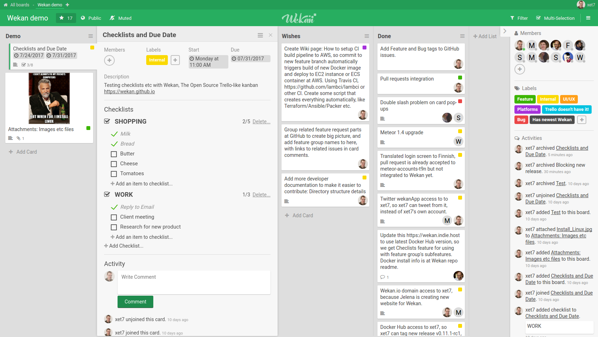
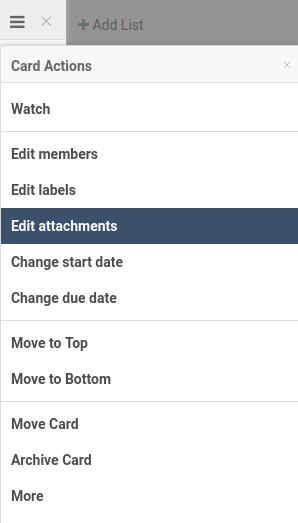
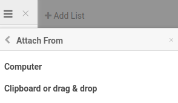
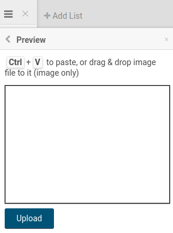
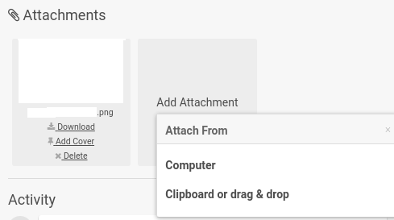
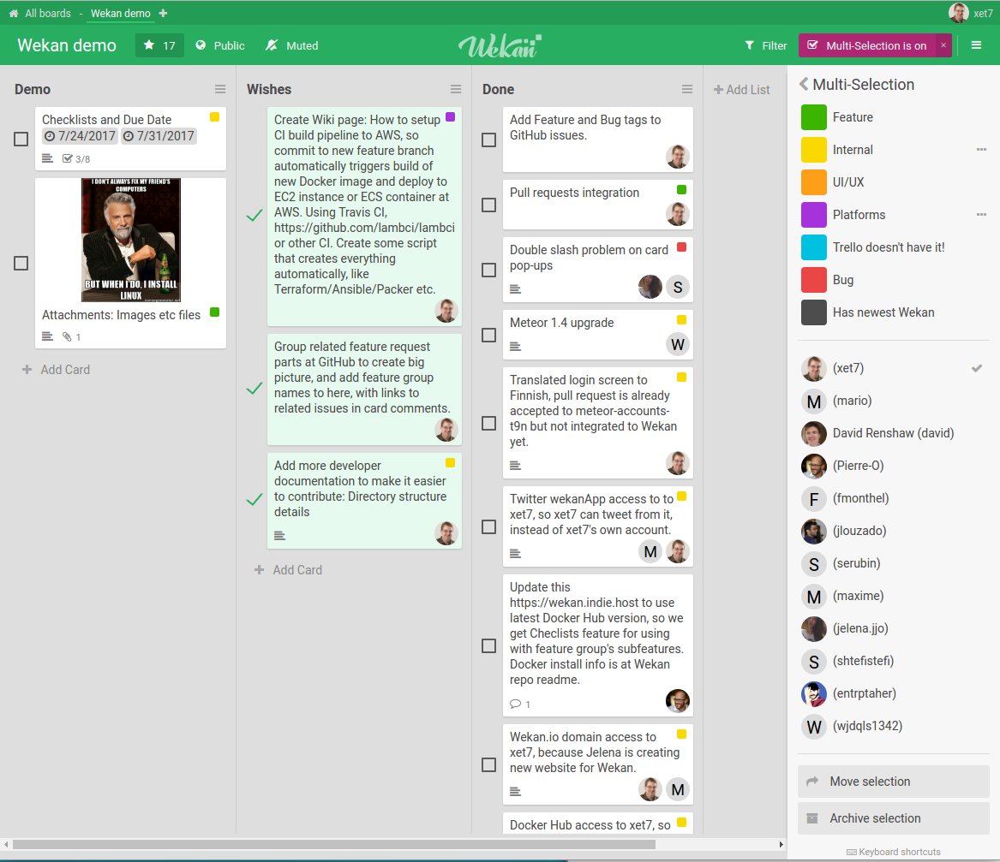
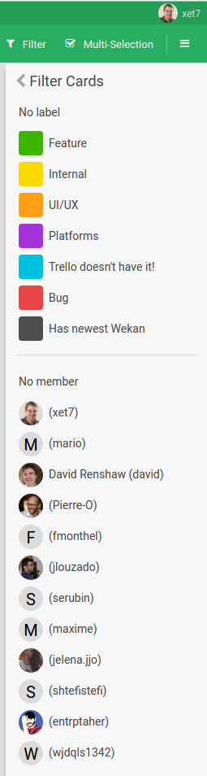

# Cards and minicards

## What it is

A card is one task or item on a board; its minicard is the small view of it
in a list. This folder documents everything on and around a card: what the
opened card shows, its sections, its menu and the helpers that work on it.
Create a card in a list, then click its minicard to open its details. The
opened card shows every field its board shows on cards, empty or not
([Card fields](Card-Fields.md)). Which fields, and in what order, on the
opened card and on the minicard, is [Card Settings](Card-Settings.md) -
[Board Settings / Card](../Board-Sidebar/Board-Settings/Card.md).

## Read more

- [Kanban board](https://en.wikipedia.org/wiki/Kanban_board) on Wikipedia.
- See the pages below for each feature.

## How to use it

1. Find the place or the action in the tables below.
2. Open its guide. Each guide says what the feature is, how to use it, how its
   numbers are calculated and how it works in WeKan.

| Place or action | Guide |
| --- | --- |
| New-card title | [Paste several cards or keep one multiline title](../Editor/Multiline.md) |
| Title, description and labels | [Cards](README.md) and [Markdown](../Editor/Markdown/README.md) |
| Date section | [Card dates](Dates/Due-Date.md); [display format](../Member-Settings/Date/README.md) is set in Date settings |
| Checklists | [Checklist items, dates and progress](Checklists.md) |
| Attachments | [Previews, downloads and storage](Attachments/README.md) |
| Comments | [Replies and editing restrictions](Comment-Replies-And-Editing-Restriction.md) |
| Custom Fields in the card menu | [Fields and their settings cog](CustomFields/README.md) |
| Subtasks heading menu | [Subtasks and their settings](Subtasks.md) |
| Linked cards | [Navigating and linking cards](Linked-Cards.md) |
| Linked custom fields | [Copy field values between two cards](CustomFields/Linked-Custom-Fields.md) |
| Card recurrence | [Recurring work](Card-Recurrence.md) |
| Planning Poker | [Estimation](Planning-Poker.md) |
| Cover, stickers and location | [Cover](Cover/README.md), [stickers](Stickers/README.md), [location](Locations/README.md) |
| History and Undo | [History](../History/README.md) and [Undo](../Undo/README.md) |
| Due date typed in the title | [Due date from the title](Dates/Due-Date-From-Title.md) |
| Similar cards | [Similar cards and possible duplicates](Similar-Cards.md) |
| At risk mark | [At risk](At-Risk.md) |
| Blocked, Class of service, MoSCoW, WSJF | [Flow fields](Flow-Fields.md) |
| Members and Assignees popups | [Suggested members](Suggested-Members.md) |
| Forecast done date | [Forecast](Dates/Forecast.md) |
| Checklists → From description | [Checklist or subtasks from the description](Checklist-From-Description.md) |
| Action items | [Action items from a comment or description](Action-Items.md) |
| Helpers that need no AI | [Overview](../Assistants/README.md) |
| Drawing → Open as whiteboard | [Whiteboard, several people at once](Whiteboard.md) |
| Export / Import | [Scope, formats and limits](../Board-Sidebar/Board-Settings/Import-Export/Format-Coverage.md) |

The opened-card heading is **Date**, not Change Date Format. Linked-card titles
navigate within the same tab; use the browser's link controls when you want a
separate tab.

## Card menu

Card menu (☰ in the opened card's header, **Card Actions**), in menu order
(`cardDetailsActionsPopup` in
[client/components/cards/cardDetails.jade](../../../client/components/cards/cardDetails.jade)).
The entries are grouped under the headings **Move and copy**, **Watch**,
**Appearance**, **Share and history** and **Archive**. Who sees which entry
is on each page.

| Entry | Guide |
| --- | --- |
| Move Card | [Move Card](Move-Card.md) |
| Copy Card | [Copy Card](Copy-Card.md) |
| Save as Template | [Templates](../All-Boards/Templates.md) |
| Copy Template to Many Cards | [Copy Template to Many Cards](Copy-Template-To-Many-Cards.md) |
| Card recurrence | [Card recurrence](Card-Recurrence.md) |
| Move to Top, Move to Bottom | [Move to Top / Bottom](Move-To-Top-Bottom.md) |
| Watch / Unwatch, Star / Unstar | [Watch, Star](Watch-Star.md) |
| Set color | [Set color](Set-Color.md) |
| Drawing | [Drawing](Drawing.md) |
| Create cards from action items | [Action items](Action-Items.md) |
| Reset width (shown when you dragged a width of your own) | [Card details width](Card-Details-Width.md) |
| Copy link to clipboard | [Board item links](../Board-Item-Links.md) |
| Link to board | [Link to board](Link-To-Board.md) |
| QR code | [QR code](QR-Code.md) |
| History | [History](../History/README.md) |
| Export, Import | [Scope, formats and limits](../Board-Sidebar/Board-Settings/Import-Export/Format-Coverage.md) |
| Move Card to Archive / Restore | [Archive and Delete](../Board-Sidebar/Archive/Archive-and-Delete.md) |
| More | [More](More.md) |
| Create board from this card | [Create-Board-From-Card.md](Create-Board-From-Card.md) |

## How the numbers are calculated

See the pages above.

## How it works in WeKan

See the pages above.

## Cards

### What it is

A **card** is a single task or item. Cards live in lists and swimlanes and can
hold a lot of detail. A card's small view on the board is its **minicard**;
clicking it opens the card's details.

What a card can contain:

- Description
- Customizable, colored labels
- Checklists (with checklist templates)
- Attachments: images and files
- Comments
- Members and assignees
- Due/start/end/received dates
- Stickers ([Stickers](Stickers/README.md))
- Locations ([Card Locations](Locations/README.md))
- A Trello-style "complete" checkbox (see below)
- Custom fields, subtasks, votes, and more



You can archive and restore a card, or delete it.

### Read more

- [Kanban board](https://en.wikipedia.org/wiki/Kanban_board) and
  [Kanban (development)](https://en.wikipedia.org/wiki/Kanban_(development))
  on Wikipedia - cards on a board of lists.
- [Trello](https://en.wikipedia.org/wiki/Trello) - where the complete
  checkbox and card aging come from.
- [Markdown](https://en.wikipedia.org/wiki/Markdown) and
  [Drag and drop](https://en.wikipedia.org/wiki/Drag_and_drop).
- In WeKan: [Cards and minicards](README.md), [Card fields](Card-Fields.md),
  [Card Settings](Card-Settings.md) and the links under Related below.

### How to use it

#### Complete checkbox

Cards have a Trello-style **"complete"** checkbox that marks a card complete or
incomplete, independent of its due date. It is shown as an animated green checkbox to
the left of the card title, both on the minicard and in the opened card, with "Mark
as complete" / "Mark as incomplete" tooltips. The checked colour follows the board
theme (or green when no theme is set), and the minicard and opened-card checkboxes
stay in sync. Subtask checkboxes and the card-detail custom-field checkbox use the
same animated checkbox style as checklist items.

1. It is off by default. Turn it on in Board Settings / **Card**, the **Date**
   section's **Mark as complete** row: *Show on Card* for the opened card,
   *Show on Minicard* for the minicard - each side separately.
2. Click the checkbox left of the title to mark the card complete; click it
   again to mark it incomplete.

> **Tip:** Normally you archive a card so you can restore it later. To delete many
> cards faster, drag them to a new list and delete that list. Deleting cannot be
> undone — the extra clicks are by design.

The complete state can also be set over the REST API via the card edit endpoint
(`PUT /api/boards/:boardId/lists/:listId/cards/:cardId`) with `{ "dueComplete": true }`:

```bash
python3 api.py setcardcomplete BOARDID LISTID CARDID true
```

#### Card aging

When **card aging** is enabled for a board, cards that have not been touched
for a while are progressively **faded** on the board, based on each card's
last activity date (Trello-style card aging). Hovering a faded card restores
it to full opacity.

1. Open the board's cog menu, **Board Settings**, then **All Boards
   Settings**.
2. Tick **Card aging (fade old cards)**.
3. Three number inputs appear under *Fade after days (3 tiers):* - the
   **day thresholds are board-configurable**, defaulting to **7 / 14 / 28**
   days. Change them as needed; each is saved when it changes.

Card aging and its thresholds can also be set over the REST API via the board
card-settings endpoint (`PUT /api/boards/:boardId/cardSettings`):

```bash
python3 api.py setcardsetting BOARDID cardAging true
python3 api.py setcardsetting BOARDID cardAgingDays1 5
python3 api.py setcardsetting BOARDID cardAgingDays2 10
python3 api.py setcardsetting BOARDID cardAgingDays3 20
```

#### Markdown and dates

- [Markdown in card description and comments](https://github.com/wekan/wekan/issues/1038)
- [International date formatting for due date according to language](https://github.com/wekan/wekan/issues/838)

#### Drag and drop / paste images

You can drag and drop images onto a card, or paste images with **Ctrl-V**.

##### 1) First attachment: open the card's 3-lines "hamburger" menu / Edit Attachments



##### 2) Select: Clipboard or drag and drop



##### 3) Drag and drop the image, or press Ctrl-V



##### 4) Add more images from the "Add Attachment" button near the first attachment



#### Multi-selection

Use multi-selection to checkmark several cards, then drag and drop all of the
selected cards to another list at once.



#### Moving a card to another board

A card moved to another board - with the card's hamburger menu / Move card, by
drag and drop, by a rule, by moving its list or swimlane, or with the REST API -
takes everything that belongs to it along: comments and their reactions, the text
note, checklists and checklist items, and attachments. They are shown on the
board the card is on now, and no longer on the board it left.

Before [#6793](https://github.com/wekan/wekan/issues/6793), comments, reactions
and text notes stayed behind: they disappeared when the card was moved and came
back when it was moved back. The startup schema upgrade (step
`card-children-boardid`) moves rows that were left behind to their card's current
board, once per new WeKan version.

The card menu's own entries are described in
[Card menu / Move Card](Move-Card.md) and
[Card menu / Copy Card](Copy-Card.md).

#### Filtered views

Filter the board by member, label, due date, and more to focus on a subset of cards.



#### Create cards from multiple lines

Paste or type multiple lines into the new-card title. The **Add** selector
offers one card with the full multiline title or one card per nonempty line.
Choose the desired count and click **Add**. Separate cards keep the pasted
order, and each receives the selected members, labels and other card options.
The same choice is available when creating lists and swimlanes.

#### Unsaved new-card titles

Closing an Add Card composer preserves its unsaved title for the same user,
list, swimlane and top/bottom position. Reopening that composer restores the
text. A successful creation clears the saved title; a partially failed batch
retains the remaining titles. Drafts use the existing private draft storage,
so another board member cannot read or overwrite them. This saves title text,
not the optional labels, members or More options fields.

### How the numbers are calculated

- **Card aging** ([client/components/cards/minicard.js](../../../client/components/cards/minicard.js)
  `agingClass`): the idle days are `(now - last activity) / 1 day`, where the
  last activity is the card's `dateLastActivity`, else `modifiedAt`, else
  `createdAt`. At or past the third threshold (default 28) the minicard is
  faded to 40 % opacity, at or past the second (default 14) to 60 %, at or
  past the first (default 7) to 85 % ([client/components/cards/minicard.css](../../../client/components/cards/minicard.css)
  `.minicard-aging-1` ... `-3`). The inputs accept whole days of 1 or more.
- **Create cards from multiple lines**: one card per nonempty line, in the
  pasted order.
- The complete checkbox has no numbers: it is one Boolean, `dueComplete`.

### How it works in WeKan

- **Complete checkbox**: the card's `dueComplete` field
  ([models/cards.js](../../../models/cards.js) `setDueComplete`), toggled by
  `js-toggle-card-complete` in
  [client/components/cards/minicard.jade](../../../client/components/cards/minicard.jade)
  and `js-toggle-due-complete` in
  [client/components/cards/cardDetails.jade](../../../client/components/cards/cardDetails.jade).
  Whether it is drawn is the board's `allowsDueComplete` (opened card) and
  `allowsDueCompleteOnMinicard` (minicard), both `false` by default
  ([models/boards.js](../../../models/boards.js)).
- **Card aging**: the board's `cardAging`, `cardAgingDays1`,
  `cardAgingDays2` and `cardAgingDays3` ([models/boards.js](../../../models/boards.js)
  `setCardAging`, `setCardAgingDays`), edited in `boardInfoOnMyBoardsPopup`
  ([client/components/sidebar/sidebar.jade](../../../client/components/sidebar/sidebar.jade),
  [sidebar.js](../../../client/components/sidebar/sidebar.js)) and over the
  REST API's `cardSettings` endpoints
  ([server/models/boards.js](../../../server/models/boards.js)).
- **Moving to another board**: the card's comments, reactions, text notes,
  checklists, checklist items and attachments carry their board id; the move
  re-points them, and the schema upgrade step `card-children-boardid` in
  [server/lib/schemaUpgradeSteps.js](../../../server/lib/schemaUpgradeSteps.js)
  repairs rows left behind.
- **Unsaved new-card titles**: the add-card composer in
  [client/components/lists/listBody.js](../../../client/components/lists/listBody.js)
  keeps the draft in the user's private draft storage.
- Tests: [tests/cardChildrenFollowMove.test.cjs](../../../tests/cardChildrenFollowMove.test.cjs),
  [tests/multilineTitles.test.cjs](../../../tests/multilineTitles.test.cjs),
  [tests/newCardTitleDraft.test.cjs](../../../tests/newCardTitleDraft.test.cjs),
  [tests/restApiNewFeatureRoutes.test.cjs](../../../tests/restApiNewFeatureRoutes.test.cjs)
  (card aging over the REST API), and the browser specs
  [tests/playwright/specs/22-card-features.e2e.js](../../../tests/playwright/specs/22-card-features.e2e.js),
  [multiline-titles.e2e.js](../../../tests/playwright/specs/multiline-titles.e2e.js),
  [new-card-title-draft.e2e.js](../../../tests/playwright/specs/new-card-title-draft.e2e.js)
  and [issue-6793-comments-follow-card-move.e2e.js](../../../tests/playwright/specs/issue-6793-comments-follow-card-move.e2e.js).

### Related

- [Linked Cards](Linked-Cards.md)
- [Card Cover Image](Cover/README.md)
- [Stickers](Stickers/README.md)
- [Card Locations](Locations/README.md)
- [Attachments and File Storage](Attachments/README.md)
- [Custom Fields](CustomFields/README.md)
- [Subtasks](Subtasks.md)
- [Templates](../All-Boards/Templates.md)
- [Markdown](../Editor/Markdown/README.md), [Emoji](../Editor/Emoji.md), [Multiline](../Editor/Multiline.md), [Numbered text](../Editor/Numbered-text.md), [LaTeX](../Editor/LaTeX.md)
- [Due Date](Dates/Due-Date.md), [Time Tracking](Time-Tracking.md)
- [Drag and Drop on Mobile and Desktop](../DragDrop/Drag-Drop.md)

## Commits

 - [The card menu's entries grouped under headings](https://github.com/wekan/wekan/commit/0d8f8b8d96b868a6d75b803ef105e50aad450977)
 - [A docs page for every card menu entry](https://github.com/wekan/wekan/commit/a8fd080bc8ece74157e5f2e9e436fa2dafe76348)
 - [The card menu in the maintainer's order](https://github.com/wekan/wekan/commit/65621f44cc03db9b2b98276ffd2c7bed8590b2fd)
 - [Comments, reactions, text notes and attachments follow a card moved to another board](https://github.com/wekan/wekan/commit/696b5b073fa73c79002fd6804d6ff5cddeef40e4)
 - [Private new-card title drafts kept across composer closes](https://github.com/wekan/wekan/commit/c7e19a3247092d519ade2a53ef7f1f2925de9409)
 - [Mixed multi-selection moves and collapsed drop targets](https://github.com/wekan/wekan/commit/b0c8acc987ff84e197215cf079085887a6829f1c)
 - [Always show the one-or-many creation choice](https://github.com/wekan/wekan/commit/cdc0722b15cd954d0eaccd235fe01f6b42537c74)
 - [Create cards, lists and swimlanes from multiline titles](https://github.com/wekan/wekan/commit/552ac0855aa64d8b9a6a9292b6da286bb08c83bb)
 - [Mark as complete gets its own Show on Minicard checkbox, off by default](https://github.com/wekan/wekan/commit/d6a8f4386671630468fa61a8e98c4435c2c97803)
 - [The Mark as complete toggle is configurable, hidden by default](https://github.com/wekan/wekan/commit/67d9de32db8829ae11ad654fee621162368eed36)
 - [Card aging with board-configurable thresholds, and the complete state over the REST API](https://github.com/wekan/wekan/commit/f0bce67a3bf301c21ded3eb97e84a3be0010290f)
 - [Trello-style complete checkbox on the minicard and the opened card](https://github.com/wekan/wekan/commit/899617bd4d83905df05fd8aab1d26630e676fee5)
