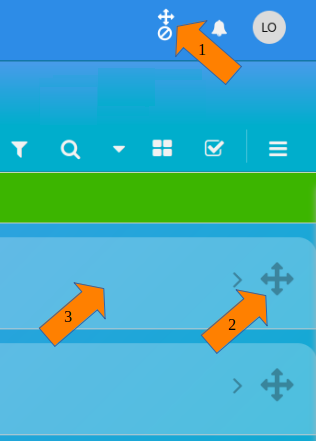

# Drag and drop

## What it is

Drag and drop is how you reorder things in WeKan: grab a board icon, swimlane,
list, minicard, checklist or checklist item and drop it where it should be. On
a touch screen, drag handles keep the rest of the item free, so dragging the
board itself pans it instead of moving a card. What a user may drag depends on
their role.

## Read more

- [Drag and drop](https://en.wikipedia.org/wiki/Drag_and_drop) on Wikipedia,
  and the [HTML Drag and Drop API](https://developer.mozilla.org/en-US/docs/Web/API/HTML_Drag_and_Drop_API)
  on MDN.
- WeKan pages: [Touch screen support](Touch-Screen-support.md),
  [REST API Role](../../../API/Role.md), [Undo / Redo](../Undo/Undo.md).

## How to use it

1. Grab the item (or its drag handle, when handles are shown) and move it.
2. Drop it between two others; a list moved to another swimlane on a touch
   screen asks for confirmation first.
3. Press `Ctrl+Z` to undo a move you did not mean.

The mobile, All Boards, board and search-result cases are described below.

## How the numbers are calculated

A dropped item gets a new `sort` number between its new neighbours
(`calculateIndexData()` in [client/lib/utils.js](../../../../client/lib/utils.js)):

- into an empty list: `0`, then `1`, `2`, ... for several items;
- before the first item: a whole number just below the next item's `sort` when
  one fits, else `next - 1`;
- after the last item: a whole number just above the previous item's `sort`
  when one fits, else `previous + 1`;
- between two items: a whole number between them when one fits, otherwise the
  step `(next - previous) / (items + 1)`, so several dropped items are spaced
  evenly.

Whether handles show is `resolveShowDragHandles(preference, isTouchScreen)` in
[models/lib/dragHandles.js](../../../../models/lib/dragHandles.js): on when the
user turned them on, off when they turned them off, and when never chosen, on
for a touch screen and off for a mouse.

## How it works in WeKan

Swimlanes, lists, minicards, checklists and checklist items are jQuery UI
sortables (`.sortable()` in
[client/components/swimlanes/swimlanes.js](../../../../client/components/swimlanes/swimlanes.js),
[client/components/lists/list.js](../../../../client/components/lists/list.js),
[client/components/cards/checklists.js](../../../../client/components/cards/checklists.js),
with shared options in [client/lib/sortableOptions.js](../../../../client/lib/sortableOptions.js));
board icons on All Boards use HTML5 drag and drop, which
[client/lib/dragDropTouch.js](../../../../client/lib/dragDropTouch.js) starts
from a long press on a touch screen. The server checks the role of every move.
Tests include [tests/dragHandles.test.cjs](../../../../tests/dragHandles.test.cjs)
and [tests/dragDropTouch.test.cjs](../../../../tests/dragDropTouch.test.cjs).

### Roles

It depends on role of user what drag drop is allowed [REST API Role](../../../API/Role.md)

### Mobile Drag Drop

1. Click the drag handles button (the arrows icon, titled **Show desktop drag
   handles**) in the header bar, or the same entry in the member menu, to enable
   drag handles

2. Use drag handles to move Board Icons, Swimlanes, MiniCards, Lists, Checklists, Checklist Items.

3. Use non-drag-handle area to to view other parts of board, by dragging board up/down/left/right, without moving any icons etc.

### 2 or more external screens of desktop or mobile

For each screen, you could enable or disable drag handles, because that setting was stored in browser localstorage, not to database. https://github.com/wekan/wekan/issues/4715

That has changed: for a logged-in user the choice is now saved in the user
profile (`profile.showDesktopDragHandles`, through the
`toggleDesktopDragHandles` method), so it follows the user to every screen.
Only when nobody is logged in is it kept in the browser's localStorage. A user
who never chose gets handles on a touch screen and none with a mouse.

Because this feature was added, `Drag Handle Enabled/Disabled` was moved to current place shown in above screenshot. https://github.com/wekan/wekan/issues/4734
It is now titled **Show desktop drag handles**, with a check mark while it is on.

### All Boards page

Reorder with drag drop:
- Board Icons

### One Board page

Reorder with drag drop:

- Swimlanes
- Lists
- MiniCards. MiniCard is card, that is not click opened to view card contents.
- Opened Card: Checklists
- Opened Card: Checklist Items

### Drag code examples

- Draggable objects
  - https://www.redblobgames.com/making-of/draggable/
  - https://news.ycombinator.com/item?id=37703291
- Fixed Drag at Ubuntu Touch Morph browser https://github.com/wekan/wekan/commit/af63259f091cb2ade84493a288ea37c53cd37321

### Touch UI ideas

- https://blog.la-terminal.net/godot-on-ipad-summer-update/
- https://news.ycombinator.com/item?id=41415077

### Drag and drop from search results

Cards shown in the board **search results** list can be dragged directly onto a board
list / column. In this initial version the card is dropped at the end of the target list
(pixel-precise insertion position is not supported yet).

## Commits

 - [The opened card and every popup move under a finger](https://github.com/wekan/wekan/commit/1b056732001674ec4c78aa1711ad1253bc0d3ebd)
 - [The drag-handle toggle works on touch screens, and the card body pans](https://github.com/wekan/wekan/commit/5a1a661e0143e9feff57d88ca44192c6137602f0)
 - [Drag search results onto a list](https://github.com/wekan/wekan/commit/b998246c353e46fd413d4fdb6626bc02cc264666)
 - [A touch to HTML5 drag-and-drop bridge, so board icons drag by finger](https://github.com/wekan/wekan/commit/1c2e1e2047f55724ce75fc42dc60e45a5db28ad5)
 - [Move the Desktop Drag Handle setting](https://github.com/wekan/wekan/commit/2be0385c254793f4ff8371d981c665fcc3878458)
 - [Fixed drag at the Ubuntu Touch Morph browser](https://github.com/wekan/wekan/commit/af63259f091cb2ade84493a288ea37c53cd37321)
