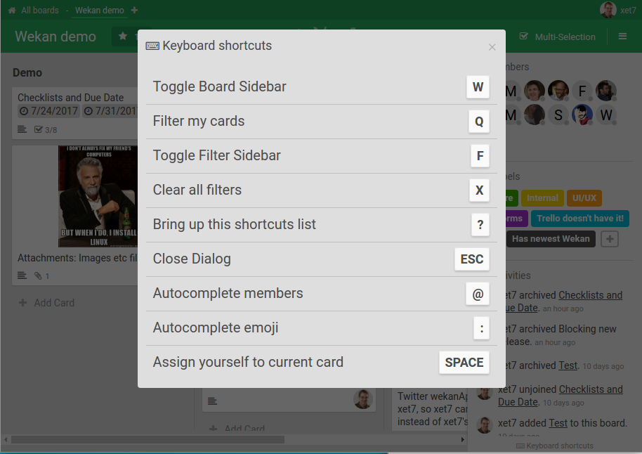

# Keyboard Shortcuts

## What it is

WeKan has many keyboard shortcuts for fast, mouse-free use: one key opens the
sidebar, filters your cards, adds you to the card, moves it to the Archive and
so on. They are on by default for every user and each user can turn them off.

## Read more

- [Keyboard shortcut](https://en.wikipedia.org/wiki/Keyboard_shortcut) on
  Wikipedia.
- [hotkeys-js](https://github.com/jaywcjlove/hotkeys-js), the library WeKan uses
  to bind the keys.
- [Accessibility](../Accessibility/Accessibility.md) — keyboard navigation, focus,
  and screen-reader support.

## How to use it

**See the list.**

1. Press **`?`** anywhere in WeKan to open the list of keyboard shortcuts.
2. Or open a board's right sidebar and click **Keyboard shortcuts** at its top.
   (An older version of this page said there is also a button at the bottom
   right corner; current WeKan has it at the top of the board sidebar.)

**Turn them on or off.** In the board's right sidebar, click the tick (or the
ban sign) beside **Keyboard shortcuts**. Its title says **Keyboard shortcuts
enabled. Click to disable.** or **Keyboard shortcuts disabled. Click to
enable.**

**Shortcuts on a board** (the list `?` shows, from `client/lib/keyboard.js`):

| Key | Action |
| --- | --- |
| `w` | Toggle Board Sidebar |
| `q` | Filter my cards |
| `a` | Filter my assigned cards |
| `n` | Add Card to Bottom of List |
| `f` | Toggle Filter Sidebar |
| `/` | Toggle Search Sidebar |
| `x` | Clear all filters |
| `?` | Bring up this shortcuts list |
| `Esc` | Close Dialog |
| `@` | Autocomplete members |
| `Space` | Add yourself to current card |
| `m` | Assign yourself to current card |
| `1`-`9` | Toggle labels 1-9 for card. Multi-Selection adds labels 1-9 |
| `Shift` + `1`-`9` | Multi-Selection removes labels 1-9 |
| `Ctrl` + `Alt` + `1`-`9` | Toggle assignees 1-9 for card (by order of addition to board) |
| `Up`, `Down` | Open the previous or next card when a card is open |
| `Ctrl` + `z` (`Cmd` + `z`) | Undo, see [Undo / Redo](../Undo/Undo.md) |
| `Ctrl` + `y`, `Ctrl` + `Shift` + `z` (`Cmd` + `Shift` + `z`) | Redo |

**Opened card.** These act on the opened card, or on the hovered or selected
minicard when no card is open:

| Key | Action |
| --- | --- |
| `d` | Edit the due date |
| `Shift` + `m` | Move Card ([#6904](https://github.com/wekan/wekan/issues/6904)) |
| `Shift` + `c` | Copy Card ([#6904](https://github.com/wekan/wekan/issues/6904)) |
| `c`, `-` (and `÷`) | Move the card to the Archive |

Move Card and Copy Card open the same popups as the card's menu, so they are
there only for those who have them in that menu: Move Card for board admins,
Copy Card for everyone who is not a Worker. The popups open on the board,
swimlane and list chosen last time.

## How the numbers are calculated

The number keys `1`-`9` pick the board's labels in their order on the board
(label `n` is `board.labels[n - 1]`; a number larger than the number of labels
does nothing), and `Ctrl` + `Alt` + `1`-`9` the board's members in the order
they were added. Labels and assignees change only for a board member. There are
no other numbers.

## How it works in WeKan

- [client/lib/keyboard.js](../../../../client/lib/keyboard.js) binds every key
  with `hotkeys()` and lists them for the `?` page (`Template.keyboardShortcuts`,
  drawn by [client/components/main/keyboardShortcuts.jade](../../../../client/components/main/keyboardShortcuts.jade)).
- `hotkeys.filter` lets a key through only when the user has shortcuts on
  (`isKeyboardShortcuts()` in [models/users.js](../../../../models/users.js),
  `profile.keyboardShortcuts`, default `true`), nothing is selected as text, and
  the focus is not in an editable field, input, select or text area. `Esc` is
  always handled. A focused control keeps the keys it uses itself.
- Keys typed on a non-Latin keyboard layout are re-dispatched once, so they work
  on any layout.
- The due date, Move Card and Copy Card keys use
  [client/lib/dueDateHotkey.js](../../../../client/lib/dueDateHotkey.js) and
  [client/lib/cardMenuHotkey.js](../../../../client/lib/cardMenuHotkey.js).
- The sidebar buttons are `js-shortcuts` and `js-keyboard-shortcuts-toggle` in
  [client/components/sidebar/sidebar.jade](../../../../client/components/sidebar/sidebar.jade).
- Tests: [tests/cardMenuKeyboardShortcut.test.cjs](../../../../tests/cardMenuKeyboardShortcut.test.cjs),
  [tests/cardShortcutPopup.test.cjs](../../../../tests/cardShortcutPopup.test.cjs),
  [tests/dueDateKeyboardShortcut.test.cjs](../../../../tests/dueDateKeyboardShortcut.test.cjs),
  [tests/keyboardEventTarget.test.cjs](../../../../tests/keyboardEventTarget.test.cjs),
  [tests/keyboardNonLatinOnce.test.cjs](../../../../tests/keyboardNonLatinOnce.test.cjs).

## Commits

 - [Card shortcuts open only their popup](https://github.com/wekan/wekan/commit/138f727ebbfc30d395fbcfa18ca244e58abe91d7)
 - [Shift+M for Move Card and Shift+C for Copy Card](https://github.com/wekan/wekan/commit/8508c150159a160b13b45505065ff788171a777a)
 - [Shortcuts run once on a non-Latin layout](https://github.com/wekan/wekan/commit/0110e84ce51a614be933fd357933123e4f793235)
 - [Shortcuts keep working after a click on a minicard or a closed popup](https://github.com/wekan/wekan/commit/ba0de93f79a1ddcdd22f19e563263ab252e3f253)
 - [d opens the Due date editor of a card that is still opening](https://github.com/wekan/wekan/commit/b1403ca7afe05f1338a5ea48dfdc80a63ab11bc3)
 - [Shortcuts on for new users, and d on a hovered card](https://github.com/wekan/wekan/commit/04a4f628e122e34d5ec19cc520dac3725d47334b)
 - [Shift shortcuts run once](https://github.com/wekan/wekan/commit/e7e2bed80f96a84ba3a2d723ac4019e6400cdc1a)
 - [The d shortcut for the Due date editor](https://github.com/wekan/wekan/commit/784d529003ebb47c70fb29e1066aa47d7bd82d5b)
 - [Filter keyboard events against the focused control](https://github.com/wekan/wekan/commit/4c40bbf9f56f59ada34fce7875a1cc26654914bd)
 - [Undo and redo for moves from the keyboard](https://github.com/wekan/wekan/commit/4ca33d29f78bd81cecc931faa5164f862823ad52)
 - [Replace mousetrap with hotkeys-js](https://github.com/wekan/wekan/commit/c795dfe96b3100c4cc471c12d0e7b188e780e844)
 - [Assignee keys toggle only current board members](https://github.com/wekan/wekan/commit/7b23c85117e97e9c83fb0e9a76b0f4d4fba24456)
 - [Change the shortcut help message](https://github.com/wekan/wekan/commit/f803190dd21fad8c2faca2a40c692a595bbe2a16)
