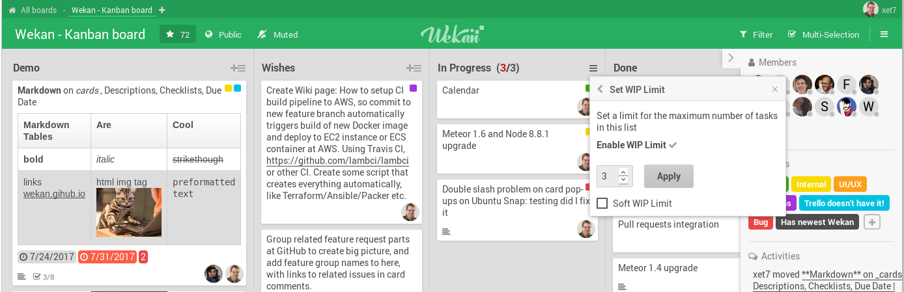
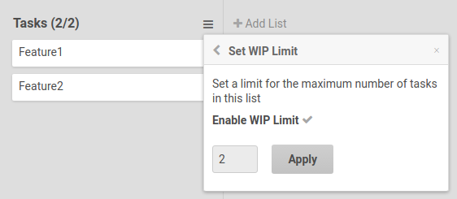

# WIP Limits

## What it is

A **Work In Progress (WIP) limit** caps how many cards a list may contain. When a
list reaches its limit, you cannot add more cards until some are moved out, which
helps the team focus and avoid overload. A **soft** WIP limit only warns: the
list is highlighted when it is over the limit, but cards can still be added.

## Read more

- [Kanban (development)](https://en.wikipedia.org/wiki/Kanban_(development))
  on Wikipedia - WIP limits as a core Kanban practice.
- [Work in process](https://en.wikipedia.org/wiki/Work_in_process) on
  Wikipedia.
- [The Kanban Guide](https://kanbanguides.org/english/) - *limit work in
  progress*.
- WeKan: [WIP Limit Groups](WIP-Limit-Groups.md) (one limit over several
  lists), [Flow policies](../Flow-Policies.md) (WIP limit per person),
  [Lists](../README.md),
  [Burndown and Velocity Chart](../../Board-Header/Board-Views/Charts/Burndown-and-Velocity-Chart.md).

## How to use it

Only **board admins** see the entry.

1. Click ☰ (**List Actions**) in the list header → **Set WIP Limit** (under
   **Settings**; it reads **Edit WIP Limit** once a limit is on).
2. Click **Enable WIP Limit**; a check mark shows it is on.
3. Type the limit (1-99) in the number box under *Set a limit for the maximum
   number of tasks in this list* and click **Apply**.
4. Optionally tick **Soft WIP Limit** to only warn instead of blocking.
5. To turn it off, click **Enable WIP Limit** again.

While the limit is on, the list header shows `(cards/limit)` after its
title, highlighted when the list is over the limit; once a hard limit is
reached, the add-card buttons are hidden.

If you apply a limit lower than the list's current card count with a hard
limit, a popup says *The number of tasks in this list is higher than the WIP
limit you've defined. Please move some tasks out of this list, or set a higher
WIP limit.* and nothing is saved.

## How the numbers are calculated

From [client/components/lists/listHeader.js](../../../../client/components/lists/listHeader.js),
[client/components/lists/listBody.js](../../../../client/components/lists/listBody.js)
and [server/models/lists.js](../../../../server/models/lists.js):

- **Count**: all of the list's non-archived cards, over every swimlane, and
  not only the cards a filter shows; with lazy card loading the server's
  count is used.
- **Reached**: `limit <= count`. A hard (not soft) limit that is reached hides
  **Add Card to Top of List** in the header and the add-card form in the list.
- **Exceeded**: `limit < count`; the `(count/limit)` text is highlighted. The
  title is also highlighted when a [WIP limit group](WIP-Limit-Groups.md) the
  list belongs to is exceeded.
- **Accepted value**: the popup accepts 1-99; anything else, or a hard limit
  below the current count, opens the error popup. The server stores 1 for a
  value that is not a number or is below 1. The default value is 1.
- **Enabling**: when a limit is turned on and its stored value is below the
  current count, the value is raised to the count first. Turning
  **Soft WIP Limit** off while the list is over the value raises the value
  to the count as well.
- **Restoring from the Archive**: a hard limit blocks restoring a card into
  the list once `count >= limit`; a soft one never blocks
  ([models/lib/wipRestore.js](../../../../models/lib/wipRestore.js)). WeKan
  then asks for another list.
- **WIP chart**: the board's WIP run chart sums the enabled limits of the
  lists between the first and the last as its limit line
  ([server/lib/boardChartData.js](../../../../server/lib/boardChartData.js)).

## How it works in WeKan

- Fields: `wipLimit.value` (default 1), `wipLimit.enabled` (default false),
  `wipLimit.soft` (default false) on the list
  ([models/lists.js](../../../../models/lists.js), `getWipLimit`,
  `setWipLimit`, `toggleWipLimit`, `toggleSoftLimit`).
- Methods `applyWipLimit`, `enableWipLimit` and `enableSoftLimit` in
  [server/models/lists.js](../../../../server/models/lists.js) require a
  signed-in board admin; a plain client update of `wipLimit` by anybody else
  is denied ([server/permissions/lists.js](../../../../server/permissions/lists.js)).
- The popups `setWipLimitPopup` and `wipLimitErrorPopup` are in
  [client/components/lists/listHeader.jade](../../../../client/components/lists/listHeader.jade).
- Tests: [tests/wipLimitPopup.test.cjs](../../../../tests/wipLimitPopup.test.cjs),
  [tests/wipLimitAdminOnly.test.cjs](../../../../tests/wipLimitAdminOnly.test.cjs),
  [tests/listWipBleed.test.cjs](../../../../tests/listWipBleed.test.cjs),
  [tests/wipRestore.test.cjs](../../../../tests/wipRestore.test.cjs),
  [tests/playwright/specs/restore-wip-limit.e2e.js](../../../../tests/playwright/specs/restore-wip-limit.e2e.js).

## Commits

 - [WeKan JSON import keeps lists' WIP limits](https://github.com/wekan/wekan/commit/24b6b9b0247bf1cda039faec6dba9298f9115116)
 - [a WIP limit is set by a board admin, on every path](https://github.com/wekan/wekan/commit/a40c4495d4d2e183872dc7dd52eddb59538b8458)
 - [restoring into a full list asks for another list](https://github.com/wekan/wekan/commit/b9edbcc8588fc8807c3cc617266daba88c781d8c)
 - [the WIP limit checkbox can be unchecked and the value is kept (#6465)](https://github.com/wekan/wekan/commit/c5d13889b6dc7020d3f61cb38124a28b856389f3)
 - [lazy card loading: accurate WIP limits](https://github.com/wekan/wekan/commit/7d5f29e11479be6a3b8393c8817b30620e99a068)
 - [ListWIPBleed: the WIP limit methods require a board admin](https://github.com/wekan/wekan/commit/8c0b4f79d8582932528ec2fdf2a4487c86770fb9)
 - [Soft WIP Limit (#1311)](https://github.com/wekan/wekan/commit/999cdb2bb9bc8f9b3615b9b54d8c51cad3011232)
 - [always restore archived cards when the limit is soft](https://github.com/wekan/wekan/commit/c17f26f6ba793f5f251ccf27f1b26c15f938a788)
 - [the soft WIP limit and the wipLimit=0 fix](https://github.com/wekan/wekan/commit/fdd1aad80de336061d576b99d86fc94694131af6)
 - [permit editing the WIP limit (#1310)](https://github.com/wekan/wekan/commit/c2173e073ef7caa46f9870d35e040108a44e9e31)
 - [hide the top add-card button too when the limit is reached](https://github.com/wekan/wekan/commit/a5daf5dc29278b82e133fbe4db09a91ffc0c0d3b)
 - [WIP Limits (#783)](https://github.com/wekan/wekan/commit/c346743234833da6210beb8580dbf1290b2fbb04)
 - [the list model gets the wipLimit field](https://github.com/wekan/wekan/commit/c9c650664fd92f0924afb4548a50c7bca167d955)
