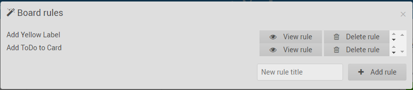
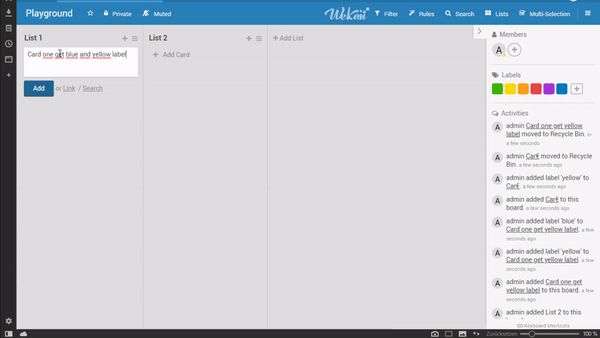

# IFTTT / Rules (Automation)

## What it is

WeKan **Rules** ("if this then that") automate your board: when something happens
(a **trigger**), WeKan runs an **action**.

> See the full, up-to-date reference at **[Features / Rules](../Rules/README.md)** —
> this page is a quick overview. The Rules page is now a **fullscreen page** (board
> sidebar → Board Settings → Rules), not a popup, and adds selecting, editing, import/export, a visual
> **Workflow view**, scheduled rules, and a REST API.

This page is the original IFTTT rules design and overview, from 2018; the
current reference is [Rules (Automation)](../Rules/README.md).

## Read more

- [IFTTT](https://en.wikipedia.org/wiki/IFTTT) on Wikipedia - the "if this then
  that" service the feature is named after.
- [Event condition action](https://en.wikipedia.org/wiki/Event_condition_action)
  - the trigger-then-action model.
- In WeKan: [Rules (Automation)](../Rules/README.md),
  [Blocks view](../Rules/Blocks.md), [Rule suggestions](../Rule-Suggestions.md).

## How to use it

The screenshots below are from the first version, when Rules was a dialog. Today
open the board's right sidebar → **Board Settings** → **Rules**.

### 1) Click: Menu item for the rules


### 2) Rule Menu: Overview, deleting and adding new rules



### 2a) Add new rule : Triggers
Currently, there are three types of triggers: board, card and checklist

| Board  | Card | Checklist |
| ------------- | ------------- | ------------- |
| create card | added/removed label, attachment, person  | checklist added/removed | 
| card moved to |   | check item checked/unchecked |
| card moved from |  | checklist completed |


### 2b) Add new rule : Actions
For every trigger, there are 4 types of actions: board, card, checklist and mail

| Board  | Card | Checklist | Mail |
| ------------- | ------------- | ------------- | ------------- |
| move card to list | add/remove label, attachment, person  | checklist add/remove | send email to |
| move to top/bottom | set title/description | check/uncheck item | |
| archive/unarchive |  | checklist complete | |

### Example: how the rules work
* Rule 1: When a card is added to the board -> Add label yellow
* Rule 2: When a card is moved to List 2 -> Add checklist ToDo
* Rule 3: When a card is added to List 1 -> Add label blue



## How the numbers are calculated

The overview has no numbers of its own. The scheduled triggers' timing (checked
every minute), the card-aging days and the rule e-mail limits are explained in
[Rules (Automation)](../Rules/README.md#how-the-numbers-are-calculated).

## How it works in WeKan

### What's new beyond the basics above

- **Scheduled triggers:** run rules on a schedule (once / daily / weekday / weekly /
  monthly at a time), on **due dates** (set / approaching / overdue), or by **card
  aging** ("a card has been in a list for N days"). Example process that works out of
  the box: *archive cards that have been in "Completed" for 90 days*.
- **Buttons:** card buttons (shown on the card) and board buttons that run an action
  on demand.
- **More actions:** sort a list, move all cards in a list, mark card complete /
  incomplete, set a date relative to now, in addition to the actions below.
- **Manage rules:** select all / unselect all, delete selected, edit (rename), and a
  visual **Workflow view** (`When … → Then …`, grouped by trigger).
- **Import / Export rules** to JSON (lossless) and CSV (round-trippable); export only
  selected rules; best-effort import of Trello **Butler** commands; import of Jira
  `automationRules`.
- **REST API** to add/edit/remove rules — see [Rules REST API](#rules-rest-api) below.

### Rules REST API

Rules can be added, edited and removed over the REST API. The trigger and action
are embedded inline so each rule is self-contained.

| Method | Path | Purpose |
| --- | --- | --- |
| `GET` | `/api/boards/:boardId/rules` | list rules |
| `GET` | `/api/boards/:boardId/rules/:ruleId` | get one rule |
| `POST` | `/api/boards/:boardId/rules` | add a rule |
| `PUT` | `/api/boards/:boardId/rules/:ruleId` | edit a rule (title / trigger / action) |
| `DELETE` | `/api/boards/:boardId/rules/:ruleId` | remove a rule (and its trigger + action) |

`POST` / `PUT` body:

```json
{
  "title": "Archive after 90 days",
  "trigger": { "activityType": "scheduledTrigger", "scheduleKind": "aging",
               "listName": "Completed", "days": 90, "atTime": "03:00" },
  "action":  { "actionType": "archive" }
}
```

Python helper ([`api.py`](../../../../api.py)):

```bash
python3 api.py listrules BOARDID
python3 api.py addrule BOARDID 'On create -> top' \
  '{"activityType":"createCard","listName":"*","swimlaneName":"*","cardTitle":"*","userId":"*"}' \
  '{"actionType":"moveCardToTop","listName":"*","swimlaneName":"*"}'
python3 api.py editrule BOARDID RULEID '{"title":"New title"}'
python3 api.py removerule BOARDID RULEID
```

See [Features / Rules](../Rules/README.md) for the full list of trigger
`activityType`s and action `actionType`s, scheduled rules, buttons, the visual
Workflow view, and Trello/Jira import.

## Pictures

This folder contains pictures and gifs for the ifttt feature. They are the pictures and GIFs
used on this page.

## Commits

 - [Rules can be shown to board members, read-only](https://github.com/wekan/wekan/commit/f4a3690256c71909860a830cb8e4557f4a2c4348)
 - [Rules card title filter and the rules REST API](https://github.com/wekan/wekan/commit/25d33cec367b867ea9970e9ad27f723b36135c45)
 - [Scheduled rules, the Workflow view, buttons and rules import/export](https://github.com/wekan/wekan/commit/f0bce67a3bf301c21ded3eb97e84a3be0010290f)
 - [Export and import of rules](https://github.com/wekan/wekan/commit/8cb132f492d3e4eb41b9f6766a59312942e345fa)
 - [Finished alpha rules](https://github.com/wekan/wekan/commit/30a3daa6af179009ac17b40a71bf3f9e9b1d698a)
 - [Completed rules](https://github.com/wekan/wekan/commit/1f5f429fc4535d251d32335eea7e44904a924650)
 - [Main flow of triggers and actions implemented](https://github.com/wekan/wekan/commit/6828ccd7f17d14f178e6742d78bdd14428ec6e07)
 - [Triggers view](https://github.com/wekan/wekan/commit/93cc7f0232ee456aff07e456b9c4601264f47ab4)
 - [UI for the rules list](https://github.com/wekan/wekan/commit/f63482b58775a2f52fdd5f932ce7d14f16757133)
